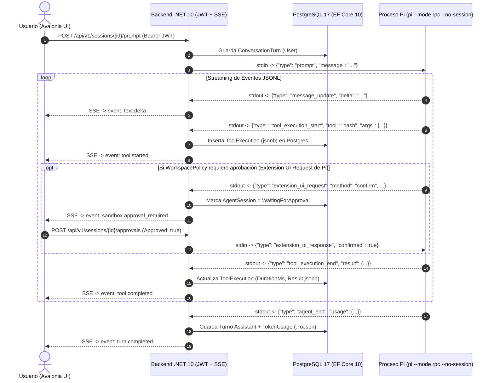

# Plan Maestro de Implementación: Open Harness (.NET 10 + EF Core 10 + PostgreSQL 17 + Pi RPC + Avalonia UI + JWT)

## 1. Visión Arquitectónica y Decisiones de Diseño

Este plan define la implementación de extremo a extremo de **Open Harness**, una plataforma empresarial de orquestación de agentes de IA y ejecución controlada de herramientas (*tool-calling* y *sandboxing*), construida sobre las versiones más modernas del ecosistema .NET en Linux (Arch Linux / Wayland):

1. **Frontend UI (`Armonia` / `Avalonia UI` sobre .NET 10)**:
   - Se estructura en dos capas estrictamente desacopladas:
     - **`OpenHarness.Client.Core`**: SDK cliente puro en .NET 10 que encapsula comunicación HTTP, autenticación JWT reactiva (`JwtAuthenticationHandler` con `SemaphoreSlim(1, 1)`) y streaming en tiempo real (`HarnessSseClient` con `System.Net.ServerSentEvents.SseParser`).
     - **`OpenHarness.UI.Avalonia`**: Capa visual multiplataforma basada en la plantilla `avalonia.mvvm` con **`CommunityToolkit.Mvvm`**, **`AvaloniaEdit`** para bloques de código/diffs coloreados y sistema de tokens de diseño **`ArmoniaDesignTokens.axaml`**.
   - *Nota de compatibilidad*: Al separar `OpenHarness.Client.Core`, si el contenedor visual se despliega en Desktop (Linux/Windows/macOS), WebAssembly o un frontend externo, los contratos de API, autenticación JWT y streaming permanecen idénticos.

2. **Motor del Agente con Integración Nativa de Pi (`pi.dev`) + Streaming SSE**:
   - En lugar de reimplementar las herramientas de bajo nivel (`read`, `write`, `edit` con *fuzzy matching* de diffs, `bash`, `glob`, `grep`, compactación de contexto y skills) desde cero, `OpenHarness.Infrastructure` integra **Pi en modo RPC (`pi --mode rpc --no-session`)** mediante un puente asíncrono (**`PiRpcSessionBridge`**) sobre `stdin`/`stdout` en formato JSONL, manteniendo la abstracción **`IChatClient` (`Microsoft.Extensions.AI`)** para flexibilidad multi-proveedor.
   - **PostgreSQL 17 (vía EF Core 10)** es la única fuente de verdad de las sesiones, turnos y auditoría de herramientas (por ello se invoca `pi` con `--no-session`).
   - Las solicitudes de confirmación (`extension_ui_request` de Pi o evaluación de `WorkspacePolicy`) pausan la ejecución de forma asíncrona sin bloquear hilos mediante **`IApprovalGate`** (`TaskCompletionSource<ApprovalDecision>`), se transmiten por **SSE nativo de ASP.NET Core 10 (`TypedResults.ServerSentEvents`)** a la UI de Avalonia, muestran el diálogo **`SandboxApprovalDialog`**, y al recibir `POST /api/v1/sessions/{id}/approvals` devuelven `extension_ui_response` al proceso `pi`.

3. **Seguridad y Autenticación JWT Zero-Allocation (.NET 10 ↔ Avalonia UI)**:
   - **Backend**: Emisión y validación en .NET 10 mediante **`JsonWebTokenHandler`** (`Microsoft.IdentityModel.JsonWebTokens`), `AddJwtBearer` con `MapInboundClaims = false`, **Access Tokens** de corta vida (10 minutos) y **Refresh Tokens rotatorios** de 7 días almacenados en PostgreSQL como hash **`SHA-256`**.
   - **Detección de robo por familia (`FamilyId`)**: Si se reutiliza un Refresh Token previamente revocado o rotado, se invalida toda la cadena de esa sesión (`FamilyId`) en una sola operación atómica con `ExecuteUpdateAsync`.
   - **Frontend**: `JwtAuthenticationHandler` (`DelegatingHandler`) sincronizado con `SemaphoreSlim(1, 1)` para refresco transparente ante `401 Unauthorized` sin condiciones de carrera, respaldado por **`PlatformSecureTokenStorage`** (Keyring/LibSecret en Linux, DPAPI en Windows, Keychain en macOS).

4. **Persistencia Moderna (PostgreSQL 17 + Entity Framework Core 10)**:
   - Contenedor `pgvector/pgvector:pg17` en `docker-compose.yml` con extensiones `vector`, `uuid-ossp` y `pg_trgm`.
   - `Npgsql.EntityFrameworkCore.PostgreSQL` (v10) con `EnableDynamicJson()`, `AddDbContextPool<OpenHarnessDbContext>`, `EnableRetryOnFailure(5)` y `UseSnakeCaseNamingConvention()`.
   - Entidades en esquema `harness` con claves primarias secuenciales **`Guid.CreateVersion7()`**, documentos tipados con `.ToJson()`, columnas nativas `jsonb` con índices **GIN (`jsonb_path_ops`)**, concurrencia optimista con `xmin` e indexación vectorial **HNSW (`vector(1536)`)**.

---

## 2. Catálogo de Versiones y Paquetes NuGet (Central Package Management)

| Capa | Paquete / Tecnología | Versión | Propósito |
|---|---|---|---|
| **SDK / Runtime** | `.NET SDK` / `C#` | `10.0.113` / `C# 14` | Runtime unificado con soporte de solución `.slnx` y mejoras AOT/Span. |
| **Backend Auth** | `Microsoft.AspNetCore.Authentication.JwtBearer` | `10.0.13` | Middleware de autenticación JWT Bearer en ASP.NET Core 10. |
| **Datos / ORM** | `Microsoft.EntityFrameworkCore` | `10.0.13` | Núcleo ORM Entity Framework Core 10 (`ToJson`, `ExecuteUpdateAsync`). |
| **Datos / ORM** | `Npgsql.EntityFrameworkCore.PostgreSQL` | `10.0.3` | Proveedor oficial EF Core 10 para PostgreSQL 17 (`jsonb`, `xmin`). |
| **Datos / Convenciones** | `EFCore.NamingConventions` | `10.0.1` | Convención automática `snake_case` para tablas, columnas e índices. |
| **Datos / Vectores** | `Pgvector.EntityFrameworkCore` | `0.3.0` | Soporte de columnas `vector(1536)` e índices `hnsw` en EF Core 10. |
| **Motor IA** | `Microsoft.Extensions.AI` | `10.11.0` | Abstracción unificada `IChatClient`, streaming y `AIFunction`. |
| **Motor Agéntico RPC** | `pi` (`pi.dev` CLI) | Local CLI (`--mode rpc`) | Ejecución de herramientas de código, diffs fuzzy y confirmaciones RPC JSONL. |
| **Frontend UI** | `Avalonia` + `Avalonia.Themes.Fluent` | `12.1.4` | Renderizado UI multiplataforma acelerado por GPU sobre .NET 10 (Wayland/X11). |
| **Frontend MVVM** | `CommunityToolkit.Mvvm` | `8.4.2` | Source Generators (`[ObservableProperty]`, `[RelayCommand]`, `IMessenger`). |
| **Editor / Diffs** | `Avalonia.AvaloniaEdit` | `12.0.0` | Bloques de código, resaltado de sintaxis, diffs y visor de herramientas. |
| **Pruebas** | `xunit` + `Testcontainers.PostgreSql` | `2.9.3` / `4.16.0` | Pruebas unitarias y de integración contra PostgreSQL 17 real en contenedor. |

---

## 3. Estructura de la Solución (`OpenHarness.slnx`)

```text
open-harness/
├── OpenHarness.slnx                          # Formato XML moderno de solución .NET 10
├── Directory.Build.props                     # TargetFramework=net10.0, LangVersion=14.0, Nullable=enable
├── Directory.Packages.props                  # Central Package Management (CPM)
├── docker-compose.yml                        # PostgreSQL 17 (pgvector/pgvector:pg17) + init scripts
├── PLAN_IMPLEMENTACION_HARNESS.md            # Plan maestro de arquitectura e implementación
├── .speckit/                                 # Artefactos SDD (Spec-Driven Development)
│   ├── constitution.md                       # Principios arquitectónicos, estándares y restricciones
│   └── features/
│       └── 001-open-harness-platform/
│           ├── spec.md                       # Requisitos funcionales (FR-###), criterios (SC-###) y casos límite
│           ├── specify.md                    # Copia espejo de compatibilidad Spec-Kit
│           ├── plan.md                       # Plan técnico detallado de la funcionalidad
│           ├── tasks.md                      # Desglose de tareas accionables por fases con trazabilidad
│           └── checklist.md                  # Puertas de calidad y verificación
├── src/
│   ├── Backend/
│   │   ├── OpenHarness.Domain/               # Entidades con Guid.CreateVersion7(), ValueObjects, Enums
│   │   ├── OpenHarness.Application/          # Vertical Slices (Auth, Sessions, Approvals, Workspaces)
│   │   ├── OpenHarness.Infrastructure/       # EF Core 10 DbContext, Npgsql, JwtTokenProvider, PiRpcSessionBridge
│   │   └── OpenHarness.Api/                  # Minimal APIs .NET 10, TypedResults.ServerSentEvents, Auth endpoints
│   └── Client/
│       ├── OpenHarness.Client.Core/          # SDK HTTP, JwtAuthenticationHandler, HarnessSseClient
│       └── OpenHarness.UI.Avalonia/          # Vistas AXAML, ArmoniaDesignTokens, ViewModels MVVM, SecureStorage
└── tests/
    ├── OpenHarness.UnitTests/                # Pruebas unitarias de dominio y aplicación
    └── OpenHarness.IntegrationTests/         # Pruebas de integración con Testcontainers.PostgreSql
```

---

## 4. Diseño de Base de Datos (PostgreSQL 17 + EF Core 10)

### 4.1. Entidades Principales (`Schema: harness`)
Todas las entidades heredan de `AuditableEntity` y generan su clave primaria en C# mediante **`Guid.CreateVersion7()`** para garantizar localidad en los índices B-Tree de PostgreSQL:

1. **`User` (`harness.users`)**:
   - `Id` (`uuid v7`), `Email` (índice único), `DisplayName`, `PasswordHash` (Argon2id/PBKDF2), `Role` (`Admin`, `Operator`, `Viewer`), `IsActive`, `CreatedAtUtc`, `UpdatedAtUtc`.
2. **`RefreshToken` (`harness.refresh_tokens`)**:
   - `Id` (`uuid v7`), `UserId` (FK a `User`), `TokenHash` (`SHA-256` hex de 64 caracteres, índice único; nunca se almacena el token en claro), `FamilyId` (`uuid v7` indexado para invalidación atómica de toda la familia ante reutilización de token revocado), `ExpiresAtUtc`, `RevokedAtUtc`, `ReplacedByTokenHash`, `RevocationReason`.
3. **`WorkspacePolicy` (`harness.workspace_policies`)**:
   - `Id` (`uuid v7`), `OwnerId` (FK a `User`), `Name`, `RootPath`, `SandboxMode` (`ReadOnly`, `WorkspaceWrite`, `DangerFullAccess`), `ApprovalPolicy` (`AlwaysAsk`, `OnDangerousAction`, `Never`), y `RulesConfig` (`WorkspaceRulesConfig` mapeado con `.ToJson("rules_config")`).
4. **`AgentSession` (`harness.agent_sessions`)**:
   - `Id` (`uuid v7`), `UserId` (FK a `User`), `WorkspacePolicyId` (FK a `WorkspacePolicy`), `ParentSessionId` (FK opcional auto-referencial para jerarquía de subagentes), `Title`, `Status` (`Idle`, `Streaming`, `WaitingForApproval`, `Completed`, `Faulted`), `ModelConfig` (`AgentModelConfig` mapeado con `.ToJson("model_config")`), `TotalInputTokens`, `TotalOutputTokens`, y `RowVersion` (`uint` mapeado a la columna de sistema `xmin` de PostgreSQL para concurrencia optimista).
5. **`ConversationTurn` (`harness.conversation_turns`)**:
   - `Id` (`uuid v7`), `SessionId` (FK a `AgentSession`), `SequenceNumber` (índice único compuesto `(SessionId, SequenceNumber)`), `Role` (`System`, `User`, `Assistant`, `Tool`), `Content`, `ThinkingContent`, `TokenUsage` (`TurnTokenUsage` mapeado con `.ToJson("token_usage")`), `Embedding` (`Pgvector.Vector?` de dimensión `vector(1536)` con índice **`hnsw (embedding vector_cosine_ops)`**).
6. **`ToolExecution` (`harness.tool_executions`)**:
   - `Id` (`uuid v7`), `SessionId` (FK a `AgentSession`), `TurnId` (FK a `ConversationTurn`), `CallId` (identificador de llamada de Pi/LLM), `ToolName`, `Arguments` (`string` en columna nativa `jsonb` con índice **GIN `jsonb_path_ops`**), `Result` (`string?` en columna nativa `jsonb` con índice **GIN `jsonb_path_ops`**), `Status` (`PendingApproval`, `Running`, `Completed`, `Failed`, `Denied`), `RequiresApproval`, `ApprovedByUserId` (FK opcional a `User`), `DurationMs`.

### 4.2. Características de EF Core 10 Aplicadas
- **`NpgsqlDataSourceBuilder`**: Configurado con `EnableDynamicJson()` y `UseVector()`.
- **`AddDbContextPool<OpenHarnessDbContext>`**: Configurado con `EnableRetryOnFailure(maxRetryCount: 5)`, `UseVector()`, `MigrationsHistoryTable("__ef_migrations_history", "harness")` y `UseSnakeCaseNamingConvention()`.
- **`AuditableEntityInterceptor` (`SaveChangesInterceptor`)**: Inyecta `TimeProvider` de .NET 10 para asignar `CreatedAtUtc` y `UpdatedAtUtc` de forma determinista.

---

## 5. Flujo de Autenticación JWT de Extremo a Extremo (.NET 10 ↔ Avalonia UI)

1. **Login Inicial (`POST /api/v1/auth/login`)**:
   - El backend valida credenciales y genera un **Access Token JWT** (10 min de vida, emitido con `JsonWebTokenHandler`) y un **Refresh Token** criptográfico aleatorio de 64 bytes (`RandomNumberGenerator.Fill`), guardando únicamente su hash `SHA-256` en PostgreSQL junto con un nuevo `FamilyId = Guid.CreateVersion7()`.
2. **Almacenamiento Seguro en el Cliente (`PlatformSecureTokenStorage`)**:
   - El **Access Token** reside exclusivamente en memoria (`AuthSessionState`).
   - El **Refresh Token** se guarda cifrado en el llavero nativo del sistema operativo (LibSecret/Keyring en Linux, DPAPI en Windows, Keychain en macOS).
3. **Refresco Reactivo sin Condiciones de Carrera (`JwtAuthenticationHandler`)**:
   - Todas las peticiones HTTP y de streaming SSE atraviesan `JwtAuthenticationHandler` (`DelegatingHandler`).
   - Ante un `401 Unauthorized`, el handler adquiere un **`SemaphoreSlim(1, 1)`**: el primer hilo invoca `POST /api/v1/auth/refresh`, rota el par de tokens y reintenta la solicitud; las peticiones concurrentes detectan que el token en memoria ya fue actualizado y reintentan directamente sin duplicar llamadas de refresco.
   - Si el backend detecta que un Refresh Token revocado vuelve a presentarse, ejecuta un `ExecuteUpdateAsync` revocando todos los tokens activos de ese `FamilyId`.

---

## 6. Motor del Agente con Pi (`pi --mode rpc`) y Streaming SSE

### 6.1. Arquitectura de Comunicación (.NET 10 ↔ Pi RPC ↔ Avalonia UI)



### 6.2. Componentes Clave del Motor
1. **`PiRpcSessionBridge`**:
   - Encapsula el subproceso `pi --mode rpc --no-session` con redirección asíncrona de `StandardInput`, `StandardOutput` y `StandardError`.
   - Expone `SendPromptAsync`, `SendApprovalResponseAsync` (`extension_ui_response`) y `ReadEventStreamAsync` (`IAsyncEnumerable<JsonDocument>`).
2. **`IApprovalGate` (`InMemoryApprovalGate`)**:
   - Gestiona solicitudes de aprobación en vuelo mediante un `ConcurrentDictionary<Guid, TaskCompletionSource<ApprovalDecision>>` para pausar de forma no bloqueante la ejecución de herramientas sujetas a `WorkspacePolicy`.
3. **Streaming SSE Nativo (`.NET 10`)**:
   - El endpoint `GET /api/v1/sessions/{id}/stream` devuelve `TypedResults.ServerSentEvents` transmitiendo eventos tipados (`text.delta`, `thinking.delta`, `tool.started`, `sandbox.approval_required`, `tool.completed`, `turn.completed`), consumidos en el cliente mediante `SseParser`.

---

## 7. Plan de Trabajo por Fases y Estado

| Fase | Alcance | Entregables y Criterios de Éxito |
|---|---|---|
| **Fase 1** | Documentación SDD, actualización del plan con Pi RPC, `OpenHarness.slnx`, `Directory.Build.props`, `Directory.Packages.props`, `docker-compose.yml`, `OpenHarness.Domain` y `OpenHarness.Infrastructure` | Artefactos SDD validados, `OpenHarnessDbContext` configurado con EF Core 10, migración inicial `InitialHarnessSchema` generada y `dotnet build` sin errores. |
| **Fase 2** | Seguridad JWT en .NET 10 | `JwtTokenProvider` (`JsonWebTokenHandler`), endpoints `/api/v1/auth/*`, rotación atómica y revocación por `FamilyId` con `ExecuteUpdateAsync`. |
| **Fase 3** | Motor del Harness con Pi RPC + SSE | `PiRpcSessionBridge` (`pi --mode rpc --no-session`), `IApprovalGate` con `TaskCompletionSource` y streaming SSE nativo (`TypedResults.ServerSentEvents`). |
| **Fase 4** | SDK Cliente (`OpenHarness.Client.Core`) | `JwtAuthenticationHandler` con `SemaphoreSlim(1, 1)`, `PlatformSecureTokenStorage` y `HarnessSseClient` (`SseParser`). |
| **Fase 5** | Interfaz Gráfica (`OpenHarness.UI.Avalonia`) | `ArmoniaDesignTokens.axaml`, layout de 3 paneles (`avalonia.mvvm`), `AvaloniaEdit` para diffs de código y `SandboxApprovalDialog`. |
